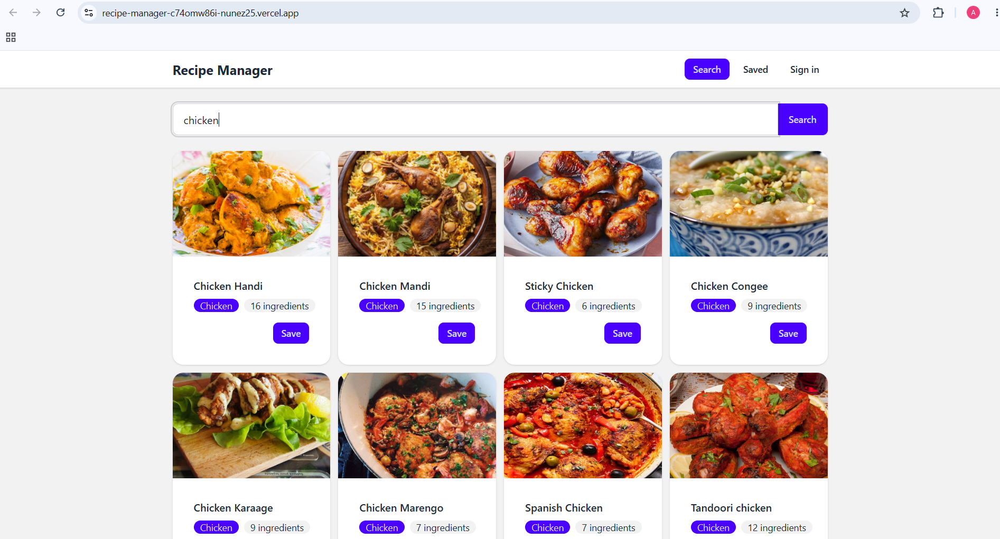

https://recipe-manager-c74omw86i-nunez25.vercel.app



## Local setup

Requires Node.js 20 or newer. From the project root, install dependencies and copy the example environment file:

```powershell
npm install
Copy-Item .env.example .env
```

Start the API in one PowerShell terminal:

```powershell
npm run api
```

Start the app in a second PowerShell terminal:

```powershell
npm run dev
```
