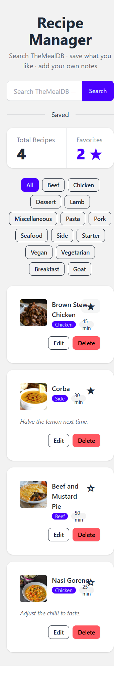

# Data-Driven Recipe App

A React and TypeScript recipe manager that searches TheMealDB, saves recipes to a local JSON API, and supports editing, deleting, category filtering, and optimistic favorites.

## Run locally

Requires Node.js 20 or newer.

```powershell
npm install
Copy-Item .env.example .env
```

Keep both processes running in separate terminals:

```powershell
npm run api
```

```powershell
npm run dev
```

The app reads the public TheMealDB catalogue and uses json-server at `http://localhost:3001` for saved recipes. `.env` is local-only; `.env.example` contains the required Vite URL settings.

## Query keys

The saved collection and category list use stable keys (`["recipes"]` and `["categories"]`). Search uses `["meals", term]`, because each query result depends on the search term; including it gives every search its own cache entry so returning to a previous term can reuse the correct results. Search is disabled until the term is non-empty.

## Optimistic favorite rollback

The favorite star updates immediately while the PATCH is pending. If the server rejects the request, the previous cached collection is restored and then invalidated so the displayed state agrees with the server.



Run a production TypeScript and Vite build with `npm run build`.
